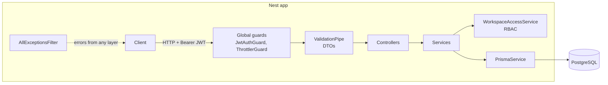
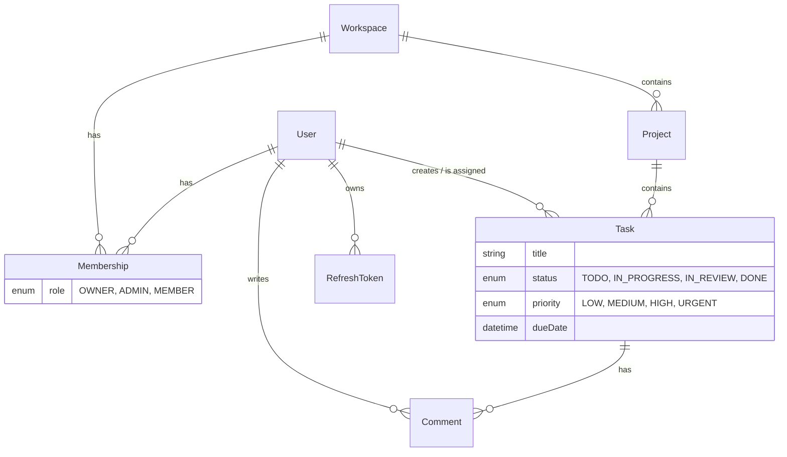

# TeamTasks API

[](https://github.com/HarWeasttt/teamtasks-api/actions/workflows/ci.yml)


REST API for a team task tracker: users create **workspaces**, invite teammates with **roles**,
organise work into **projects** and **tasks**, and discuss tasks in **comments**.

## Features

- **JWT authentication** with short-lived access tokens (15 min) and refresh tokens (7 days)
  - refresh token **rotation**: each refresh token is single-use
  - **reuse detection**: replaying an already-used refresh token revokes all of the user's sessions
  - only SHA-256 hashes of refresh tokens are stored; passwords are hashed with bcrypt
- **Role-based access control** per workspace: `OWNER` > `ADMIN` > `MEMBER`
  - non-members get `404` instead of `403`, so they can't find out a resource exists
- **Tasks with filtering, search, sorting and pagination**
  `GET /projects/:id/tasks?status=TODO,IN_PROGRESS&priority=HIGH&assigneeId=…&search=login&dueBefore=2026-12-01&sortBy=dueDate&order=asc&page=1&limit=20`
- **Validation** of every request body/query with DTOs (`class-validator`); unknown fields are rejected
- **Centralised error handling**: one exception filter returns a consistent error shape and maps
  Prisma errors (`P2002` → 409, `P2025` → 404, `P2003` → 400)
- Rate limiting (stricter on `/auth/*`), Helmet security headers, CORS, env validation on startup
- **OpenAPI / Swagger** documentation generated from the code
- **Tests**: 33 unit tests + 18 e2e tests against a real PostgreSQL database
- **Docker** multi-stage image, **docker-compose** for local development, **GitHub Actions** CI

## Tech stack

| Area | Tools |
| --- | --- |
| Language / runtime | TypeScript (strict), Node.js 22 |
| Framework | NestJS 11 (Express) |
| Database | PostgreSQL 16, Prisma ORM + migrations |
| Auth | `@nestjs/jwt`, bcrypt |
| Validation / docs | class-validator, class-transformer, `@nestjs/swagger` |
| Testing | Jest, Supertest |
| Tooling | ESLint (typescript-eslint), Prettier, Docker, GitHub Actions |

## Architecture

Each feature is a NestJS module with a thin **controller** (HTTP: routes, DTOs, status codes) and a
**service** (business rules, database access through Prisma). Authorization rules live in one place,
`WorkspaceAccessService`, and every module uses it.



```
src/
├── auth/            register, login, refresh rotation, logout, JwtAuthGuard
├── workspaces/      workspaces, members & roles, WorkspaceAccessService (RBAC)
├── projects/        projects inside a workspace, task statistics
├── tasks/           tasks CRUD, query builder for filters/sorting
├── comments/        comments on tasks
├── health/          GET /health (app + DB check for the hosting platform)
├── common/          exception filter, pagination, decorators (@Public, @CurrentUser)
├── config/          environment variable validation
├── database/        idempotent demo seed
└── prisma/          PrismaService
prisma/              schema.prisma + SQL migrations
test/                e2e tests (Supertest + real database)
```

### Data model



### Permissions

| Action | MEMBER | ADMIN | OWNER |
| --- | :-: | :-: | :-: |
| View workspace, projects, tasks, comments | ✅ | ✅ | ✅ |
| Create / update tasks, write comments | ✅ | ✅ | ✅ |
| Delete own tasks / comments | ✅ | ✅ | ✅ |
| Delete anyone's tasks / comments | | ✅ | ✅ |
| Create / update / delete projects, rename workspace | | ✅ | ✅ |
| Add / remove members | | ✅ | ✅ |
| Change member roles, delete workspace | | | ✅ |

## API overview

Full interactive documentation is available at **`/docs`** (Swagger UI) and **`/docs-json`** (OpenAPI spec).

| Method | Endpoint | Description |
| --- | --- | --- |
| POST | `/auth/register` · `/auth/login` | get an access + refresh token pair |
| POST | `/auth/refresh` · `/auth/logout` | rotate / revoke a refresh token |
| GET | `/auth/me` | current user |
| GET, POST | `/workspaces` | my workspaces (paginated) / create |
| GET, PATCH, DELETE | `/workspaces/:id` | details / rename / delete |
| GET, POST | `/workspaces/:id/members` | list / add by email |
| PATCH, DELETE | `/workspaces/:id/members/:userId` | change role / remove or leave |
| GET, POST | `/workspaces/:id/projects` | list (search, paginated) / create |
| GET, PATCH, DELETE | `/projects/:id` | details with task stats / update / delete |
| GET, POST | `/projects/:id/tasks` | list with filters / create |
| GET, PATCH, DELETE | `/tasks/:id` | details / update / delete |
| GET, POST | `/tasks/:id/comments` | list / add |
| DELETE | `/comments/:id` | delete |
| GET | `/health` | health check |

Paginated responses look like this:

```json
{
  "data": [{ "id": "…", "title": "Implement login page", "status": "IN_PROGRESS" }],
  "meta": { "page": 1, "limit": 20, "total": 42, "totalPages": 3 }
}
```

Errors always look like this:

```json
{
  "statusCode": 400,
  "error": "Bad Request",
  "message": ["title must be shorter than or equal to 200 characters"],
  "path": "/projects/4f…/tasks",
  "timestamp": "2026-11-08T12:00:00.000Z"
}
```

## Running locally

Requirements: Node.js 20+, Docker.

### Option 1: everything in Docker

```bash
docker compose up --build
```

The API runs on http://localhost:3000 and Swagger on http://localhost:3000/docs.
Migrations and demo data are applied automatically on startup.
Log in with the demo account `demo@teamtasks.dev` / `DemoPassw0rd!` or register your own.

### Option 2: Node locally, database in Docker

```bash
npm install
cp .env.example .env
docker compose up -d db     # PostgreSQL on :5432 (also creates the teamtasks_test database)
npx prisma migrate dev      # apply migrations
npm run db:seed             # optional: demo data
npm run start:dev           # watch mode
```

### Tests

```bash
npm test             # unit tests
npm run test:cov     # unit tests + coverage report
npm run test:e2e     # e2e tests, need the database from docker compose (uses .env.test)
npm run lint
```

The e2e tests start the full Nest application with the same pipes and filters as production
(`src/app.setup.ts`) and run real HTTP requests against a separate `teamtasks_test` database.

## CI

GitHub Actions ([`.github/workflows/ci.yml`](.github/workflows/ci.yml)) runs on every push and pull request:

1. ESLint + Prettier check
2. TypeScript type check
3. Unit tests with coverage
4. E2E tests against a PostgreSQL service container
5. Production build
6. Docker image build

The production Docker image is self-contained: on startup it runs `prisma migrate deploy` and an
idempotent demo seed, then starts the server. It honours `X-Forwarded-For`, so it can run behind a reverse proxy.

## Environment variables

| Variable | Description | Default |
| --- | --- | --- |
| `DATABASE_URL` | PostgreSQL connection string | required |
| `JWT_ACCESS_SECRET` / `JWT_REFRESH_SECRET` | signing secrets, min. 32 chars each | required |
| `JWT_ACCESS_TTL` / `JWT_REFRESH_TTL` | token lifetime in seconds | `900` / `604800` |
| `PORT` | HTTP port | `3000` |
| `CORS_ORIGIN` | allowed origin | `*` |
| `THROTTLE_LIMIT` / `AUTH_THROTTLE_LIMIT` | requests per minute per IP (global / auth routes) | `100` / `10` |

The app validates these on startup and refuses to start if something is missing.

## License

MIT
